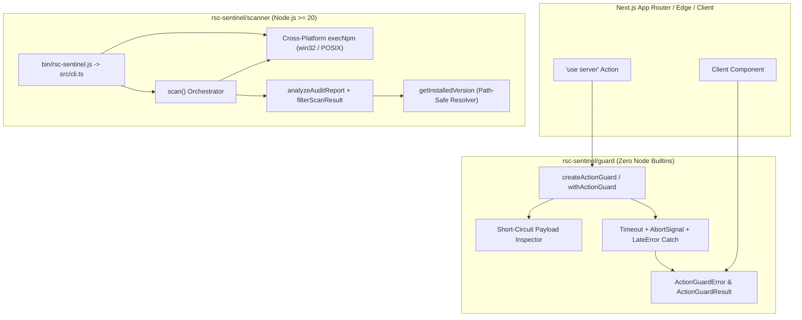

# System Architecture — `rsc-sentinel`

## 1. High-Level Architecture

`rsc-sentinel` is intentionally split into **two isolated runtime domains** exposed through explicit `package.json` subpath exports so Next.js bundlers (Turbopack / Webpack) never pull Node.js-only modules into Edge or Client graphs.

---

## 2. Package Entrypoint & Subpath Isolation

| Entrypoint | Source File | Runtime Target | Node.js Builtins? |
| --- | --- | --- | --- |
| `rsc-sentinel/guard` | `src/guard.ts` | Next.js Server Actions, Edge Runtime, Browser/Client, Node.js | **NONE** (Web APIs only) |
| `rsc-sentinel/scanner` | `src/scanner.ts` | Node.js `>= 20` (CI, scripts, dev tools) | `node:child_process`, `node:fs`, `node:path`, `node:util` |
| `rsc-sentinel` (root) | `src/index.ts` | Node.js `>= 20` convenience barrel | Re-exports both |
| `rsc-sentinel` (CLI bin) | `bin/rsc-sentinel.js` -> `src/cli.ts` | Node.js `>= 20` terminal / CI | Node builtins |

---

## 3. Data Flow

### 3.1 Scanner Pipeline
1. **Pre-flight validation (`runNpmAudit`):** Verifies `package.json` (`NO_PACKAGE_JSON`) and `package-lock.json` (`NO_LOCKFILE`).
2. **Cross-platform execution (`execNpm`):** Runs `npm audit --json` with a 32 MiB buffer cap and configurable timeout (default 60s). On Windows, safely dispatches via `cmd.exe /d /s /c npm ...` with `windowsHide: true` and fixed static arguments.
3. **Schema validation:** Rejects non-JSON, `{ error: ... }` payloads, `null`, and non-object `vulnerabilities` shapes.
4. **Normalization (`analyzeAuditReport`):**
   - Skips transitive string pointers in `via`.
   - Deduplicates by `(packageName, advisoryUrl)`.
   - Resolves actual installed version from `node_modules` via `vuln.nodes` → local `node_modules` → hoisted ancestor `node_modules`.
   - Normalizes `fixAvailable` (`true` | `false` | `{ name, version, isSemVerMajor }`).
   - Classifies `isRscRelated` and sorts deterministically.
5. **Filtering (`filterScanResult`):** Applies optional `rscOnly` and `minSeverity` thresholds and recomputes severity totals and `clean`.

### 3.2 Server Action Guard Pipeline
1. **Eager config validation:** Rejects invalid numeric limits (`NaN`, `Infinity`, `<= 0`) with `RangeError` at guard construction time.
2. **Pre-execution inspection (`inspectArguments`):**
   - `FormData`: counts entries (`maxFormDataEntries`) and UTF-8 bytes of keys, string values, `Blob.size`, and `File.name` (`maxFormDataBytes`), short-circuiting on first breach.
   - Non-`FormData`: traverses strings, `Blob`, `ArrayBuffer`, `TypedArray`, `Map`, `Set`, arrays, and own enumerable object keys with depth enforcement (`maxObjectDepth`), cycle tracking (`WeakSet`), and byte caps (`maxPayloadBytes`).
3. **Bounded execution (`executeGuarded`):**
   - Creates an `AbortController` and passes `controller.signal` to the action.
   - Races the action promise against a `setTimeout` promise.
   - Attaches a late-rejection handler to the action promise so post-timeout rejections never crash Node.js with `UnhandledPromiseRejection`.
   - Always clears the timer in `finally`.
4. **Result serialization (`safeRun` / `wrapSafe`):**
   - Re-throws Next.js control-flow errors (`NEXT_REDIRECT`, `NEXT_NOT_FOUND`, `NEXT_HTTP_ERROR_FALLBACK`) untouched.
   - Converts `ActionGuardError` into `{ ok: false, error: { reason, message } }` so Next.js production error sanitization never hides guard feedback from Client Components.
